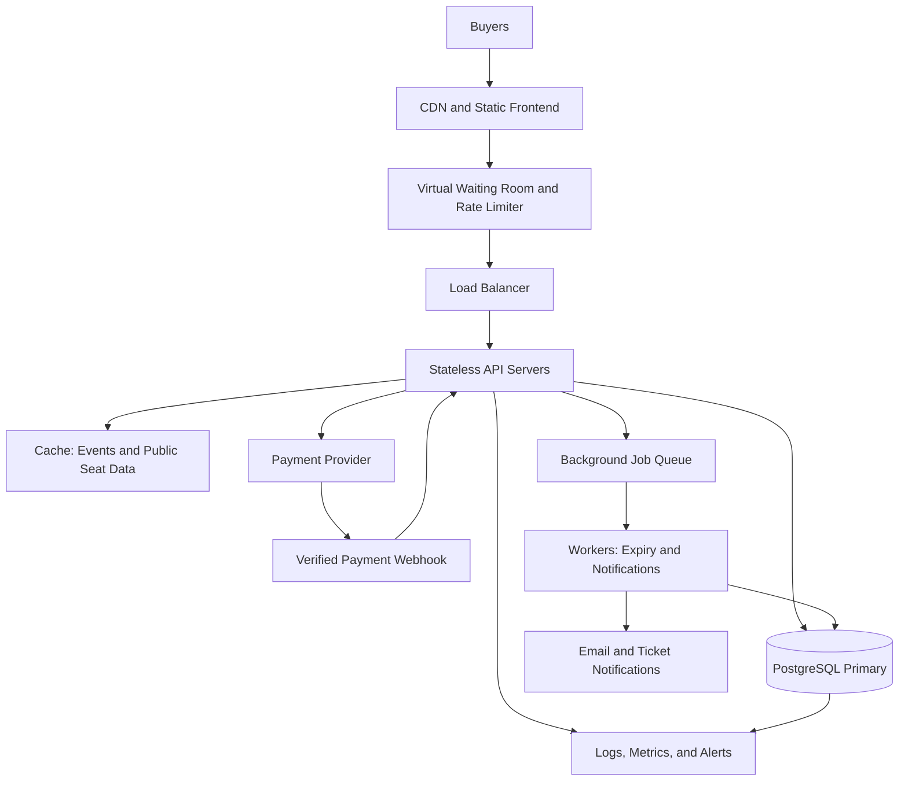

# TicketHub: System Design

## 1. Requirements

### Functional requirements

- Users can register, log in, and manage their accounts.
- Users can browse concerts and events, search by name or location, and view event details.
- Users can view a venue's seats and see whether each seat is available, held, or sold.
- Users can temporarily hold available seats while completing checkout.
- Users can pay for their orders and receive booking confirmations.
- Users can view their purchased tickets and order history.
- Administrators can create events, configure seats, and manage ticket availability.

### Non-functional requirements

- **Speed:** Event pages should load within 2 seconds under normal conditions. Seat availability and hold requests should normally respond within 500 milliseconds, excluding external payment processing.
- **Correctness:** A seat must never be sold to two different orders. Payments and ticket issuance must remain consistent.
- **Fairness:** Users should enter a virtual waiting room during high-demand sales. Requests should be processed in queue order as far as practical, with rate limits to reduce bots and abuse.
- **Availability:** The website should remain usable during traffic spikes, even if non-essential features are temporarily delayed.
- **Security:** Authentication, authorization, HTTPS, payment-provider integration, and protection against common web attacks are required. Card details should be handled by a compliant payment provider.
- **Scalability:** Application servers should scale horizontally to handle increased traffic.
- **Maintainability:** The system should use clear APIs, automated tests, monitoring, and documented database migrations.

## 2. Traffic Estimates

### Normal traffic

Given:
- Registered users: 2,000,000
- Daily visitors: 50,000
- Average pages per visitor: 10
- Daily ticket sales: 5,000

Page views per day:

50,000 × 10 = 500,000 page views/day.

Average page-view request rate:

500,000 ÷ 86,400 ≈ 5.8 requests/second.

Average ticket sales rate:

5,000 ÷ 86,400 ≈ 0.058 sales/second, or about 208 sales/hour.

Actual traffic will be higher during busy hours. For capacity planning, assume a normal busy-hour peak of approximately 60 page-view requests/second, about 10 times the daily average.

### Popular concert sale

Given:
- 200,000 people attempt to buy tickets in 10 minutes.
- Only 20,000 seats are available.

Average incoming buyer rate:

200,000 ÷ 600 ≈ 333 buyer attempts/second.

Seat inventory rate if all 20,000 seats sell within 10 minutes:

20,000 ÷ 600 ≈ 33 seats/second.

Demand-to-supply ratio:

200,000 ÷ 20,000 = 10 people per seat.

If each buyer generates 10 page or API requests during the sale, the system could receive approximately 2,000,000 requests in 10 minutes, averaging 3,333 requests/second. Short bursts may be much higher.

### Comparison and capacity plan

The sale's average buyer arrival rate is approximately 5.7 times the estimated normal busy-hour page-view rate. The illustrative 3,333 requests/second workload is approximately 56 times that normal busy-hour rate.

These are planning estimates, not measured results. Load testing should determine actual capacity. TicketHub should use a virtual waiting room, request throttling, caching, horizontally scaled application servers, and database connection pooling. The waiting room should release buyers at a controlled rate based on the database's safe processing capacity.

## 3. API Design

All endpoints use HTTPS and return JSON. Protected endpoints require authentication and authorization.

| Method and endpoint | Purpose |
|---|---|
| GET `/api/events` | Browse and search events, with pagination and filters. |
| GET `/api/events/:eventId` | View event details, venue information, and sale status. |
| GET `/api/events/:eventId/seats` | View seat availability and prices. |
| POST `/api/holds` | Atomically hold one or more available seats for a limited time. |
| DELETE `/api/holds/:holdId` | Release a hold before checkout, if it has not been converted into an order. |
| POST `/api/orders` | Create a pending order from valid seat holds. |
| POST `/api/orders/:orderId/payment` | Initiate payment through the payment provider using an idempotency key. |
| POST `/api/payments/webhook` | Process verified payment-provider notifications and update order status. |
| GET `/api/me/tickets` | Return the authenticated user's purchased tickets. |
| GET `/api/me/orders/:orderId` | View an order and its payment status. |

The server must validate seat IDs, prices, hold ownership, and hold expiration. Clients must never determine the final price or mark an order as paid themselves.

A hold request should return a hold ID and expiry time. If a requested seat is already held or sold, the server returns a conflict response, such as HTTP 409. Repeated payment requests with the same idempotency key must not create duplicate charges.

## 4. Data Model

The database uses PostgreSQL with foreign keys, unique constraints, transactions, and indexes.

### Table: `users`

- `id`: UUID primary key.
- `email`: Unique, not null.
- `full_name`: Not null.
- `created_at`: Timestamp.

### Table: `events`

- `id`: UUID primary key.
- `name`: Not null.
- `venue`: Not null.
- `starts_at`: Timestamp.
- `status`: Draft, on-sale, or completed.
- `created_at`: Timestamp.

### Table: `seats`

- `id`: UUID primary key.
- `event_id`: Foreign key referencing `events.id`.
- `seat_number`: Not null.
- `price`: Not null and non-negative.
- `status`: Available, held, or sold.
- `hold_id`: Nullable reference to the active hold.
- `hold_expires_at`: Nullable timestamp.

Constraint: `UNIQUE (event_id, seat_number)` ensures that the same seat number cannot be created twice for an event.

### Table: `orders`

- `id`: UUID primary key.
- `user_id`: Foreign key referencing `users.id`.
- `status`: Pending, paid, failed, or cancelled.
- `total_amount`: Not null and non-negative.
- `payment_reference`: Nullable unique payment-provider reference.
- `created_at`: Timestamp.

### Table: `seat_holds`

- `id`: UUID primary key.
- `user_id`: Foreign key referencing `users.id`.
- `expires_at`: Not null timestamp.
- `status`: Active, converted, released, or expired.
- `created_at`: Timestamp.

### Table: `order_items`

- `id`: UUID primary key.
- `order_id`: Foreign key referencing `orders.id`.
- `seat_id`: Foreign key referencing `seats.id`.
- `price_at_purchase`: Not null and non-negative.

Constraint: `UNIQUE (seat_id)` in `order_items` prevents a seat from appearing in multiple orders. It should be retained as a permanent sales-history constraint rather than removed when a hold expires.

### Relationships

- One user can create many orders.
- One user can create many seat holds.
- One event has many seats.
- One order contains one or more order items.
- Each order item references one seat.
- Each seat belongs to one event.
- Each hold can cover multiple seats; the active hold reference and expiry are maintained consistently.

Indexes should support event searches, event-to-seat lookups, order history by user, and expiry processing for active holds.

## 5. Preventing Double-Booking

TicketHub must enforce seat ownership in the database, not rely only on the frontend.

### Step 1: Hold seats atomically

When a user requests a seat, the server starts a database transaction and locks the relevant seat row using `SELECT ... FOR UPDATE`. It checks that the seat is available or that a previous hold has expired. If eligible, it records the hold ID and expiry time, then commits.

If another buyer requests the same seat simultaneously, that request must wait for the lock and then re-check the committed state. It cannot successfully create a competing active hold.

### Step 2: Enforce database constraints

The unique constraint on `(event_id, seat_number)` prevents duplicate seat records. The unique constraint on `order_items.seat_id` prevents the same seat from being sold in multiple orders, even if application logic contains a bug.

### Step 3: Complete checkout safely

Within a transaction, the server verifies that the hold belongs to the buyer, has not expired, and still covers the requested seats. It creates the pending order and order items and reserves the seats for that order. If any check or constraint fails, the transaction rolls back.

Payment is performed through an external provider and cannot safely be part of a single PostgreSQL transaction. After a verified payment confirmation, an idempotent transaction marks the order paid and the seats sold. A failed or expired checkout releases inventory only after confirming that no successful payment has occurred. Payment webhooks must be authenticated and safe to process more than once.

This combination of row locking, transactions, unique constraints, hold expiration, and idempotent payment handling prevents double-booking and reduces duplicate charges.

## 6. Architecture

### Component explanations

1. **CDN and static frontend:** Serves JavaScript, CSS, images, and other static assets close to users, reducing origin traffic.
2. **Virtual waiting room and rate limiter:** Queues excess buyers and limits abusive or excessive requests. It releases traffic at a controlled rate rather than allowing all buyers to overload the database.
3. **Load balancer:** Distributes requests among healthy API servers.
4. **Stateless API servers:** Authenticate users, validate requests, enforce business rules, and scale horizontally. Shared session state is not stored only in server memory.
5. **Cache:** Speeds up event listings and other public data. Seat availability shown from cache is informational only; all holds and purchases must be validated against the authoritative database.
6. **PostgreSQL primary:** Stores users, events, seats, holds, orders, and order items. Transactions, row locks, and constraints protect correctness.
7. **Background queue and workers:** Process expired holds, email delivery, and ticket notifications without delaying customer requests.
8. **Payment provider and webhook:** Process payments externally and notify TicketHub of verified outcomes. Idempotency protects against duplicate processing.
9. **Monitoring:** Tracks request latency, errors, queue length, database locks, failed payments, and remaining inventory. Alerts help operators respond before the sale fails.

### How the architecture survives the big sale

The CDN absorbs static-content requests, while the waiting room limits how many buyers reach the API and database at once. Load-balanced stateless servers can scale horizontally. Caching reduces repeated reads, and a connection pool protects PostgreSQL from too many simultaneous connections.

Seat holds and sales remain serialized at the database level for each contested seat. Monitoring, load tests, database backups, and tested recovery procedures support reliability. The system should degrade gracefully: if traffic is too high, buyers wait instead of receiving incorrect availability or being charged for the same seat.

## 7. Trade-offs

### Trade-off 1: Strong consistency versus performance

Using PostgreSQL transactions and row locks makes seat allocation correct, but highly contested seats can cause waiting and lock contention. A cache-first or eventually consistent purchase system might appear faster, but it risks selling seats that are no longer available. TicketHub prioritizes correctness for holds and purchases while caching non-critical reads.

### Trade-off 2: Fairness versus speed

A virtual waiting room makes traffic manageable and gives buyers a more orderly process, but it adds waiting time and system complexity. Letting everyone enter immediately might reduce perceived waiting for some users but could overload the database and disadvantage others. TicketHub uses a transparent queue policy, rate limits, and monitoring.

### Trade-off 3: Availability versus database simplicity

A single PostgreSQL primary is simpler and supports clear transactional guarantees, but it can become a bottleneck or a single point of failure. Replicas and failover improve resilience, but introduce operational complexity and possible stale reads. TicketHub can use read replicas for suitable read-only workloads while keeping seat allocation and purchase decisions on the authoritative primary.

## Conclusion

TicketHub is designed to handle two million registered users and a surge of 200,000 buyers competing for 20,000 seats. Its main priorities are correct seat allocation, controlled traffic, fair access, secure payments, and scalable delivery. Database constraints and transactions remain the final authority on who gets a seat.